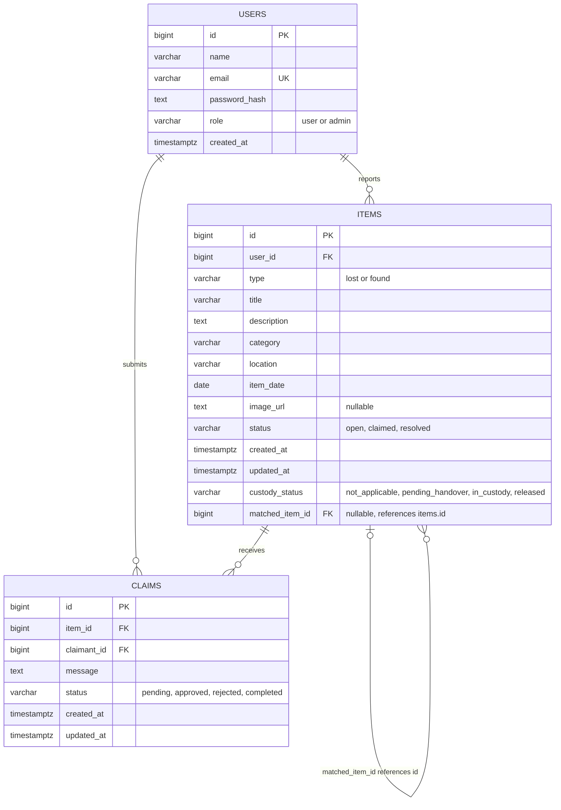

# Entity-Relationship Diagram

## Relationship explanation

- **Users → Items:** One user can report multiple lost or found items. Each item belongs to one reporting user.
- **Users → Claims:** One user can submit multiple claims. Each claim belongs to one claimant.
- **Items → Claims:** One item can have multiple claims. Each claim refers to one item.
- **Items → Items:** An item can optionally reference another item through `matched_item_id`. The referenced item can be associated with multiple items; the database does not enforce a one-to-one match.

## Database constraints

- `users.email` is unique.
- `users.role` is restricted to `user` or `admin`.
- `items.type` is restricted to `lost` or `found`.
- `items.status` is restricted to `open`, `claimed`, or `resolved`.
- `items.custody_status` is restricted to `not_applicable`, `pending_handover`, `in_custody`, or `released`.
- `items.matched_item_id` is nullable, references `items.id`, and cannot reference the same item.
- `claims` has a unique constraint on `(item_id, claimant_id)`, preventing a user from creating multiple claims for the same item.
- `claims.status` permits `pending`, `approved`, `rejected`, or `completed` after migration `003_claim_completion.sql`.
- Foreign keys enforce the relationships between users, items, and claims.

## Schema files

Apply the database files in this order:

1. `database/schema.sql`
2. `database/migrations/002_custody_workflow.sql`
3. `database/migrations/003_claim_completion.sql`
